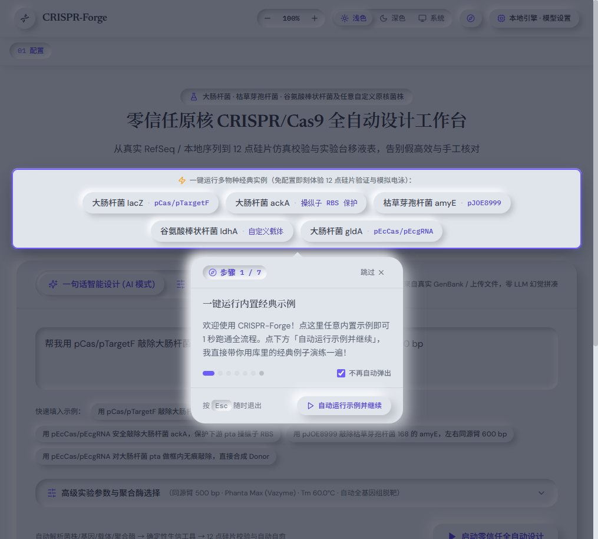
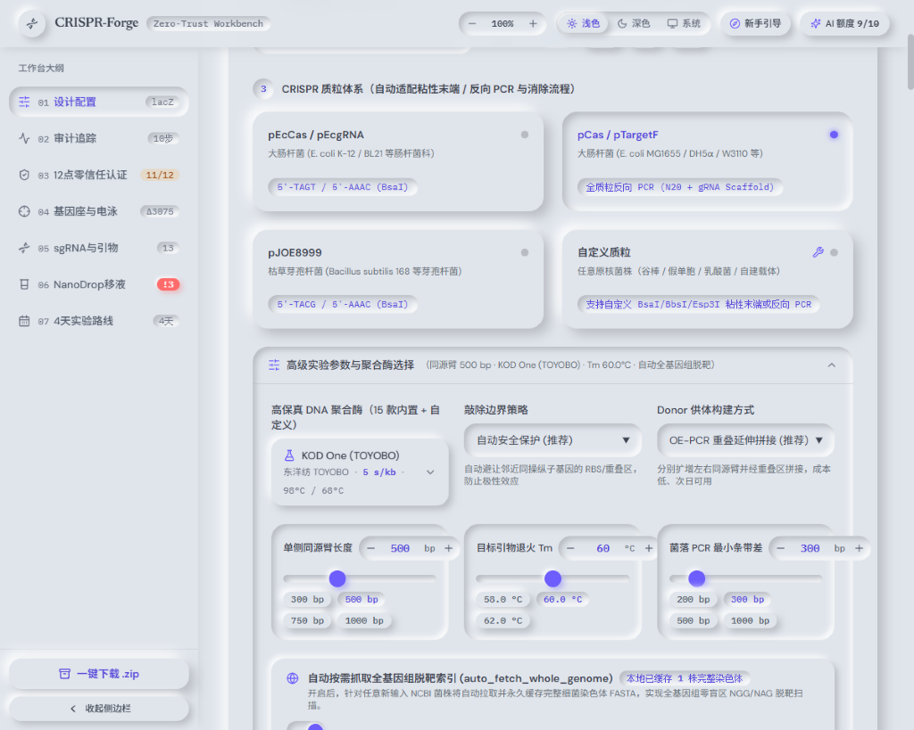
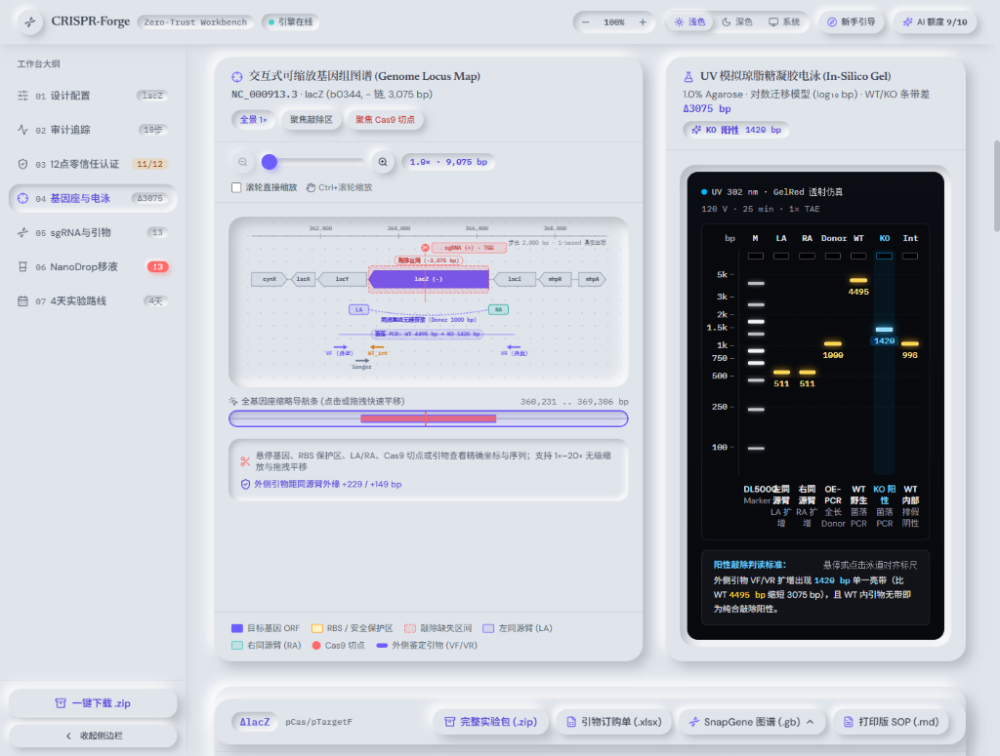
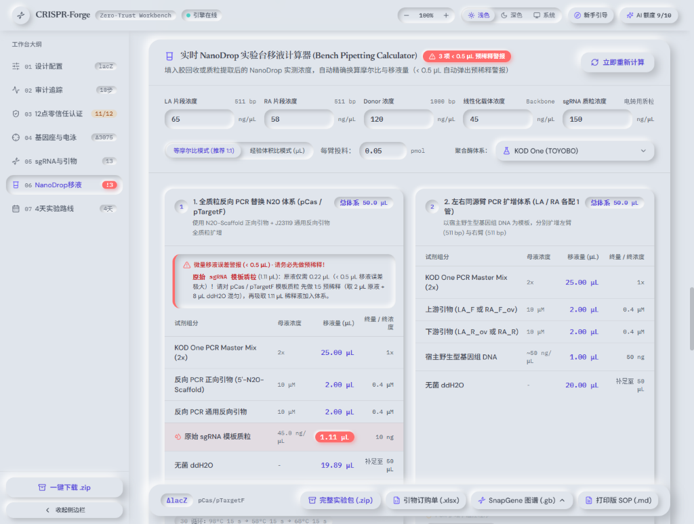
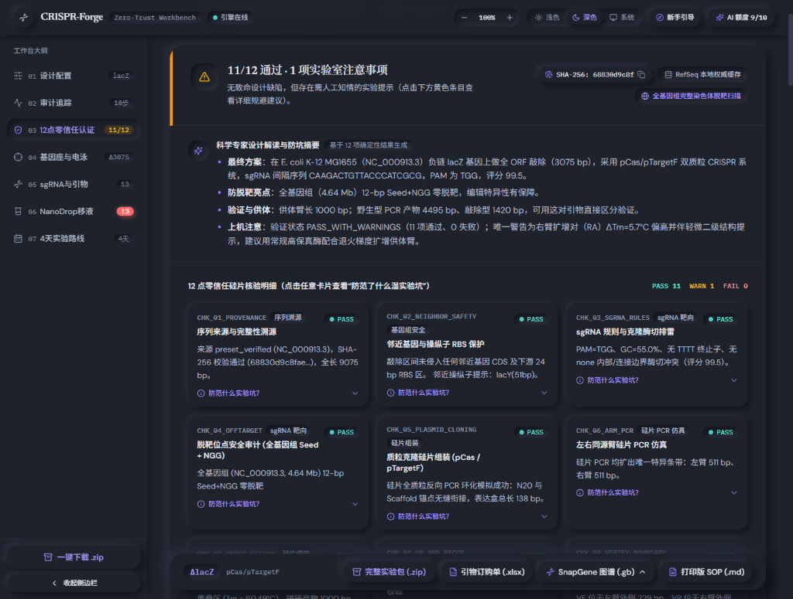

# CRISPR-Forge — 零信任原核生物基因编辑设计与验证工作台

> **在线体验地址（Live Demo）**：[**https://crispr-forge.onrender.com/**](https://crispr-forge.onrender.com/)
> *(免费云端实例若超过 15 分钟无访问会自动休眠，首次唤醒约需 30–50 秒，请稍候即可正常使用)*

> **核心理念**：大模型只负责自然语言意图解析、异常修复决策与结果简报，**绝不凭空编造任何 DNA 序列**；所有基因组溯源、脱靶检索、引物热力学、硅片仿真与移液换算全部由确定性代码内核执行，**12 项自动核验通过后才输出可执行交付包**。

---

## 核心特性

### 1. 通用跨底盘支持（不再局限于内置模式菌株）
- **菌株名称模糊检索（内置 + NCBI 实时联网）**：支持中英文输入任意常见或冷门原核菌株名称（如“大肠杆菌”、“BL21”、“枯草芽孢杆菌”、“恶臭假单胞菌”、“链霉菌”等），自动联想官方 RefSeq Accession，无需手动查库。
- **任意底盘全基因组自动按需抓取**：内置缓存大肠杆菌（4.64 Mb）、枯草芽孢杆菌（4.22 Mb）、谷氨酸棒状杆菌（3.28 Mb）三物种完整染色体；输入任意其他 NCBI RefSeq 底盘时自动在线抓取并永久缓存，实现全基因组级脱靶核验。
- **支持本地私有文件上传**：直接拖入 `.gb / .gbk`（自动解析全部注释与邻近基因边界）或无注释纯 `.fasta` 文件（支持自动识别中心区最长编码框或自定义起止坐标）。

### 2. 通用载体体系 + 空白载体 `.gb` 自动识别
- 开箱支持 3 套实验室高频体系（`pEcCas/pEcgRNA`、`pCas/pTargetF`、`pJOE8999`）与通用自定义体系；
- **上传空白载体 `.gb` 自动解析**：面向未收录的自建载体，直接拖入空白图谱文件，后端自动识别克隆策略、酶切粘性末端、抗性标记并生成真实骨架验证引物，支持**一键保存至浏览器本地「我的常用载体库」**长期复用。

### 3. 12 点零信任 *In Silico* 硅片验证与自愈闭环
- 自动执行 12 项确定性代码验证：序列 SHA-256 溯源、邻近基因与 24 bp RBS 保护、克隆酶切位点排雷、全基因组脱靶扫描、质粒组装仿真、同源臂扩增仿真、拼接仿真、同源重组与防二次切割验证、外侧跨位点验证引物防假阳性检查、电泳分辨率校验、热力学审计及合成纯化标注；
- 校验出现阻断项时读取结构化修复提示，自动触发最多 3 轮**自愈重试**，直至核心检查全部通过。

### 4. 实验台零手算交付与可定制科研工作台
- **15 款主流聚合酶可搜索大库 + 自定义聚合酶**：覆盖 Vazyme、TOYOBO、Takara、NEB、TransGen、Yeasen、Thermo 主力高保真与菌落酶，支持自定义品牌/延伸速率/变性与退火偏移，前后端联动精准计算反应程序；
- **实时 NanoDrop 移液计算器**：填入实测浓度后实时换算微升数（支持等摩尔比 / 体积比切换），自动拦截 **`< 0.5 μL` 微量移液误差并给出精确预稀释比例**；
- **交互式可视化与一键交付**：`1×–20×` 缩放/拖拽基因座图谱 + UV 模拟琼脂糖凝胶电泳 + 一键导出 4 份带注释 `.gb` 图谱、引物订购单 `.xlsx`、打印版 `.md` 文档与 `.zip` 完整实验包；
- **日间 / 夜间统一新拟物工作台（Day & Night Tactile Soft-UI）**：采用浅色黏土浮雕（`#e0e5ec`）与深色哑光炭灰浮雕（`#1e222b`）双态立体软 UI，搭配 `Newsreader / Noto Serif SC`、`DM Sans / Noto Sans SC` 与 `IBM Plex Mono` 排版；提供左侧可折叠工作台大纲（`01`–`07` 模块与实时状态角标）、`浅色 / 深色 / 系统` 三态主题切换、顶栏 **「新手引导」** 聚光灯教程，以及 **`84%–120%` 按 `2%` 步进 / `1%` 无级滑块** 的细粒度字号调节。

---

## 完整使用说明（图文分步指引）

### 第 1 步：开屏交互指引与一键示例体验
首次进入 [**https://crispr-forge.onrender.com/**](https://crispr-forge.onrender.com/) 时，系统会在页面对应位置自动弹出 7 步聚光灯指引（点击顶栏 **「新手引导」** 按钮可随时重开）。你可以直接点击卡片内的 **「自动运行示例并继续」**，立即使用库内置多物种经典案例跑通完整流程；也可直接在首页输入框用一句话描述目标菌株、基因与载体系统。



### 第 2 步：菌株检索 / 上传、载体体系与高级参数配置
结果生成后顶部表单会自动收敛为单行摘要，点击 **「修改参数 / 新建设计」** 即可切换至 **「3 步快捷配置 / 上传序列」**，并通过左侧工作台大纲栏在 `01`–`07` 各模块间快速跳转：
- **菌株与基因**：输入中英文菌株名或 RefSeq 编号进行模糊联想，或切至上传模式拖入本地 `.gb / .fasta`；
- **载体选择与自定义识别**：选用内置高频载体，或点选 **「自定义质粒」** 并拖入空白载体 `.gb` 文件自动提取克隆位点、抗性与验证引物并保存至本地常用库；
- **高级参数与试剂库**：展开 **「高级实验参数与聚合酶选择」**，在 15 款聚合酶（如 `KOD One`、`Phanta Max`）中快速搜索选择或添加自定义酶，并用精细滑块设定单侧同源臂长度、目标引物退火 Tm、菌落 PCR 最小条带差与全基因组脱靶索引策略。



### 第 3 步：可缩放基因座图谱与 UV 模拟凝胶电泳
进入 `04 基因座与电泳` 视图，左侧图谱与右侧模拟胶图同屏联动：
- **交互式可缩放基因组图谱**：提供 `全景 1×`、`聚焦敲除区`、`聚焦 Cas9 切点` 快捷定位，支持 `Ctrl + 滚轮`（或开启滚轮直缩）、左键拖拽平移与底部缩略导航条，悬停可查看目的基因、`RBS / 安全保护区`、左右同源臂、切点及外侧验证引物坐标；
- **UV 模拟琼脂糖凝胶电泳**：保留暗场 `UV 302 nm · GelRed` 透射仿真腔体，同屏直观比对 `M`、`LA`、`RA`、`Donor`、`WT`、`KO` 与 `Int` 7 泳道条带大小、条带差及阳性敲除判读标准。



### 第 4 步：实时移液换算、红色微量警戒与一键交付导出
定位至 `06 NanoDrop移液` 实验台计算器，填入胶回收或质粒实测浓度后即可在 **「等摩尔比模式」** 与 **「经验体积比模式」** 间切换并实时刷新反应体积：
- **微量移液红标警报**：一旦任一组分所需体积 `< 0.5 μL`，系统会立即亮起高对比度珊瑚红预稀释警报并给出精确稀释方案，同时在左侧大纲栏对应区块显示 `!N` 红色计数角标防止漏看；
- **多格式一键交付**：通过底部悬浮导出栏可一键下载含全套文件的 `.zip` 实验包、`.xlsx` 引物订购单、4 份带注释 SnapGene `.gb` 图谱及打印版 `.md` SOP 文档。



### 第 5 步：深色模式（Night Tactile Soft-UI）与 12 点零信任认证
点击顶栏主题切换器的 **「深色」** 按钮可切换至夜间软 UI 界面（`#1e222b` 哑光炭灰基底与对称高光/暗影浮雕），兼顾暗光实验室环境阅读与长时核验操作：
- **12 点确定性硅片核验明细**：在 `03 12点零信任认证` 模块展示序列 `SHA-256` 溯源摘要、基于 12 项确定性结果生成的专家解读简报，以及可逐条展开查看「防范什么实验坑？」的核验卡片矩阵。



### 模型额度与自带 Key（BYOK）配置
- **零 Key 免费运行**：不配置任何大模型 Key 时，全部确定性序列检索、靶点与引物计算、12 点校验、移液换算与文件导出均 100% 免费不限次数；
- **访客自带 Key（BYOK）**：点击右上角模型按钮，选择 DeepSeek / 通义千问 / OpenRouter 并填入个人 Key（仅保存在浏览器本地），可不限次数使用自然语言解析与智能报告摘要。

---

## 量化评测结果（Benchmark）

运行 `backend\.venv\Scripts\python.exe backend\eval\benchmark.py --mode deterministic` 实测结果：

- **跨物种真实任务零阻断通过率**：**100.0%（6/6，全员全基因组脱靶扫描）**
- **经典设计陷阱拦截率**：**100.0%（4/4）**
- **后端自动化测试**：**23 / 23 全部通过**

| 任务 ID | 目标基因 | 载体体系 | 脱靶范围 | 12 点通过 | 阻断项 | 预期条带 WT / KO (bp) | 耗时 (ms) |
| :--- | :--- | :--- | :--- | :---: | :---: | :---: | :---: |
| `T01_Ecoli_lacZ_pTargetF` | `lacZ` | `pCas/pTargetF` | `whole_genome` | 11/12 | **0** | `4495 / 1420` | 1382 |
| `T02_Ecoli_ackA_pEcgRNA` | `ackA` | `pEcCas/pEcgRNA` | `whole_genome` | 12/12 | **0** | `2692 / 1489` | 696 |
| `T03_Ecoli_pta_KeioInFrame` | `pta` | `pEcCas/pEcgRNA` | `whole_genome` | 12/12 | **0** | `3527 / 1412` | 685 |
| `T04_Ecoli_gldA_RevStrand` | `gldA` | `pEcCas/pEcgRNA` | `whole_genome` | 12/12 | **0** | `2440 / 1336` | 688 |
| `T05_Bsubtilis_amyE_pJOE8999` | `amyE` | `pJOE8999` | `whole_genome` | 11/12 | **0** | `3697 / 1717` | 1184 |
| `T06_Cglutamicum_ldhA_Custom` | `ldhA` | `custom` | `whole_genome` | 12/12 | **0** | `2412 / 1467` | 1314 |

---

## 本地运行与 Docker 部署

### 1. Windows 本地一键启动
```powershell
# 可选：配置 DeepSeek 免费体验额度
copy backend\.env.example backend\.env

# 一键启动后端 (8000) + 前端 (3000) 并自动打开浏览器
.\start.ps1
```

### 2. Docker Compose 一键部署
```bash
export LLM_API_KEY=sk-your-deepseek-key
export FREE_TRIAL_DAILY_LIMIT=10
docker compose up -d --build
```

---

## MCP Server 接入（Claude Desktop / Cursor / Antigravity）

```json
{
  "mcpServers": {
    "crispr-forge": {
      "command": "<path-to-crispr-forge>\\backend\\.venv\\Scripts\\python.exe",
      "args": ["-m", "crispr_forge.agent.mcp_server"]
    }
  }
}
```
*(macOS / Linux 环境请将 `command` 替换为 `<path-to-crispr-forge>/backend/.venv/bin/python`)*

---

## 开发与测试命令

```powershell
# 运行全量后端测试（含载体 .gb 自动解析、菌株检索、跨物种与陷阱测试）
backend\.venv\Scripts\pytest.exe backend\tests -v

# 运行跨物种与陷阱量化评测
backend\.venv\Scripts\python.exe backend\eval\benchmark.py --mode deterministic

# 前端类型检查与生产构建
cd frontend && npm run build
```
